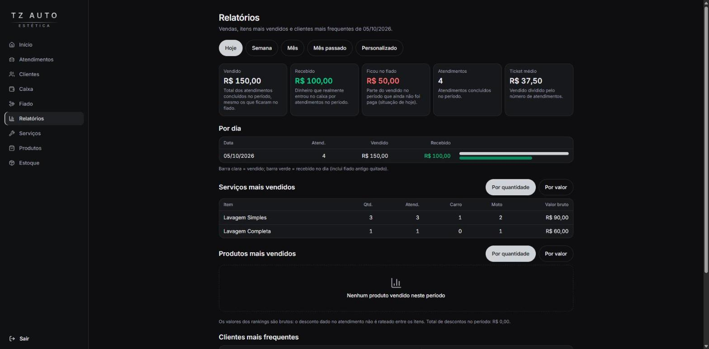
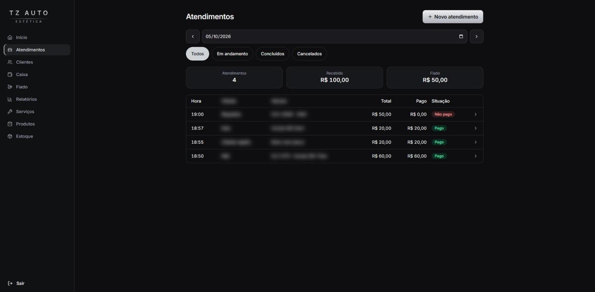
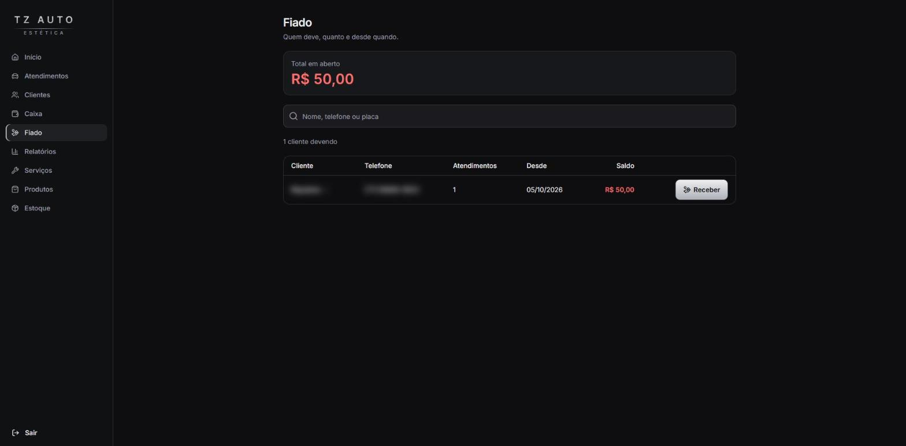
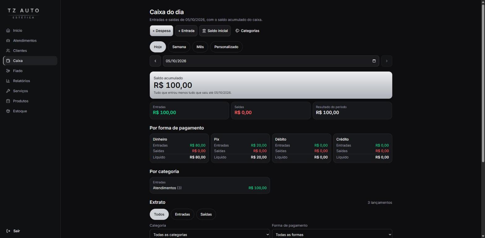

# CRM Lava Jato

Sistema web de gestão para um lava jato que atende carros e motos: cadastro de clientes e veículos, atendimentos com recebimento, controle de fiado, caixa, estoque e relatórios.

Projeto construído do zero para o **TZ Auto Estética** e já em produção. O design visual ainda está em fase de refinamento, mas o sistema funciona de ponta a ponta.

> Os prints abaixo vêm do sistema em produção. Nomes, placas e telefones de clientes foram borrados.

## Telas

| Relatórios | Atendimentos |
| --- | --- |
|  |  |

| Fiado | Caixa |
| --- | --- |
|  |  |

## Funcionalidades

- **Login** de usuário único, com sessão em cookie assinado e limite de tentativas.
- **Clientes e veículos**: um cliente pode ter vários veículos (carro ou moto), com busca única por nome, telefone ou placa.
- **Catálogo de serviços** com preço diferente para carro e moto.
- **Atendimentos**: serviços e produtos no mesmo atendimento, desconto, e recebimento em dinheiro, Pix, débito ou crédito.
- **Fiado**: atendimento concluído sem pagamento ou com pagamento parcial, saldo devedor por cliente e recebimento de várias pendências de uma vez.
- **Caixa**: entradas e saídas, categorias, extrato por período e saldo acumulado.
- **Produtos e estoque**: entradas, baixas, acerto de inventário e baixa automática quando um produto é vendido no atendimento.
- **Relatórios**: vendido, recebido, fiado do período, ticket médio, serviços e produtos mais vendidos e clientes mais frequentes.

## Stack

- **Next.js** (App Router) e **React**, com **TypeScript** estrito
- **Prisma** como ORM: SQLite em desenvolvimento e PostgreSQL (Neon) em produção
- **Tailwind CSS** e **shadcn/ui**
- **Zod** e **React Hook Form** para validação
- **Vitest** (testes unitários) e **Playwright** (testes e2e, inclusive contra Postgres)
- **Vercel** para o deploy e **GitHub Actions** para automações

## Decisões técnicas

- **Dinheiro em centavos** (inteiros), nunca em float. A conversão de e para o formato BRL fica em um único módulo testado.
- **Transações** em toda escrita que toca mais de uma tabela, como concluir um atendimento, que grava pagamentos e baixa estoque.
- **Datas em UTC** no banco e exibidas em `America/Sao_Paulo`. Agrupamentos por dia são feitos em TypeScript para não depender de funções de data que diferem entre SQLite e Postgres.
- **Regras de negócio isoladas** em `src/server/`, separadas das telas, para serem testadas sem interface.
- **Mesma suíte em dois bancos**: os testes e2e rodam em SQLite e em Postgres para pegar diferenças entre eles antes de ir para produção.
- **Entregas pequenas e verificáveis**: cada entrega tem objetivo, telas e critérios de aceite escritos antes do código (veja o roadmap).

## Como rodar localmente

Requisitos: Node.js 22.

```bash
npm install
cp .env.example .env
npm run db:migrate
npm run db:seed
npm run dev
```

Depois abra `http://localhost:3000` e entre com o usuário de desenvolvimento definido no `.env.example` (`SEED_USER_EMAIL` e `SEED_USER_PASSWORD`). Esses valores servem só para desenvolvimento e o script de seed recusa rodar em produção.

## Testes e qualidade

```bash
npm run lint
npm run typecheck
npm test            # unitários (Vitest)
npm run test:e2e    # ponta a ponta (Playwright)
npm run test:pg     # mesma suíte contra um Postgres local
```

## Estrutura do projeto

```
src/app/        rotas e telas (Next.js App Router)
src/server/     regras de negócio e acesso a dados, por domínio
src/lib/        utilitários (dinheiro, datas, placas, formatação)
src/components/ componentes de interface
prisma/         schema, migrations e seeds
e2e/            testes de ponta a ponta
docs/           roadmap, decisões, modelo de dados e guia de deploy
```

## Documentação

- [Roadmap e critérios de aceite](docs/roadmap.md)
- [Decisões técnicas e de negócio](docs/decisoes.md)
- [Modelo de dados](docs/modelo-dados.md)
- [Guia de deploy (Vercel + Neon)](docs/deploy.md)

## Status

Entregas 0 a 10 concluídas (MVP em produção, mais fiado, caixa, estoque, venda de produtos e relatórios). Próximas: lembretes de fiado atrasado via WhatsApp, agendamento de atendimentos e identidade visual.

## Como foi desenvolvido

Usei agentes de IA (Claude) no fluxo de desenvolvimento, cada um com um papel definido em [`.claude/agents`](.claude/agents): tech lead, backend, frontend e QA. Eu conduzi o escopo e as decisões de cada entrega e validei o resultado com os testes. Os papéis e regras dos agentes estão no repositório para quem quiser ver como o trabalho foi organizado.

## Autor

Breno Ferreira, buscando a primeira oportunidade como desenvolvedor júnior remoto. Fico feliz em trocar ideia sobre o projeto.
